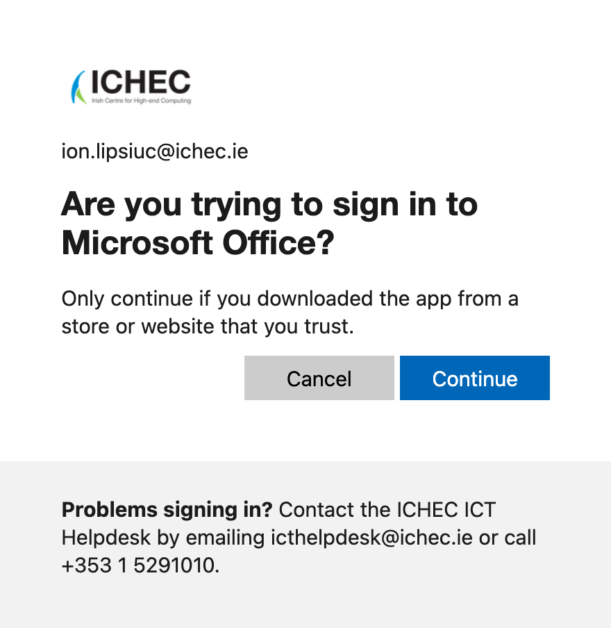

# aerc

## macOS

```shell
brew install aerc
```

### aerc setup for Microsoft 365

> [!NOTE]
> The following documents my attempt to get my ICHEC Outlook account working on
> aerc.

As per <https://man.sr.ht/~rjarry/aerc/providers/microsofto365.md>, we move
forward with the assumption that IMAP is enabled. As per [Microsoft
Email](https://man.sr.ht/~rjarry/aerc/providers/microsofto365.md#microsoft-email),
all we have to do is modify `accounts.conf` after the initial setup.

I wasn't too confident about this method after going through [POP, IMAP, and
SMTP settings for
Outlook](https://support.microsoft.com/en-us/outlook/pop-imap-and-smtp-settings-for-outlook-com)
and seeing the following note:


No luck with this method.

Instead of wasting time with the assumption that IMAP is enabled, we move on to
[Office365 with IMAP
disabled](https://man.sr.ht/~rjarry/aerc/providers/microsofto365.md#office365-with-imap-disabled).
Download latest [Azul Zulu Build of
OpenJDK](https://www.azul.com/downloads/?os=macos&package=jdk-fx#zulu) and
[`DavMail-MacOSX-7.1.0-4498.app.zip`](https://sourceforge.net/projects/davmail/files/davmail/7.1.0/DavMail-MacOSX-7.1.0-4498.app.zip/download).
Follow guide given in [DavMail Setup on macOS](https://davmail.sourceforge.net/macosxsetup.html).

Everything was going smoothly until the following:


Fortunately, there is a [way to bypass this
approval](https://github.com/mguessan/davmail/issues/321#issuecomment-1867072418)...

It works! Simply add the following to `~/.config/davmail/davmail.properties`:

```text
davmail.oauth.clientId=d3590ed6-52b3-4102-aeff-aad2292ab01c
davmail.oauth.redirectUri=urn:ietf:wg:oauth:2.0:oob
```

DavMail will then show a pop-up. You need to log in via ICHEC's SSO page. Stop
once you reach the following page:



Inspect the page's source and navigate to Network. Once in, click Continue and
you will see a new URL under Network. Open it and copy the Location value.
Paste it into DavMail's pop-up.

### Proton Mail

Within Proton Mail, navigate to Settings > All settings > IMAP/SMTP and install
Bridge for macOS.

Launch the CLI:

```shell
/Applications/Proton\ Mail\ Bridge.app/Contents/MacOS/Proton\ Mail\ Bridge –c
```

The above command will not actually work. Why? See the following explanation:

````ai
The problem is the dash. The process list shows Bridge was started with `–c`, which is an en dash (U+2013), not a hyphen. That usually happens when you copy a command from a web page or when macOS swaps in "smart punctuation" as you type. The launcher doesn't recognize `–c` as a flag, so it just passes it along and opens the GUI as usual. You can see it in the running processes:

```
31859 .../Proton Mail Bridge –c
31863 .../bridge --grpc ... –c ...
```

To fix it:

1. **Quit the Bridge instance that's running now.** If it stays open, the new one may not start because only one Bridge can run at a time. Use the menu bar icon and choose Quit, or run:
   ```
   pkill -f "Proton Mail Bridge.app"
   ```
2. **Start it again, typing two plain hyphens yourself:**
   ```
   /Applications/Proton\ Mail\ Bridge.app/Contents/MacOS/Proton\ Mail\ Bridge --cli
   ```
   `-c` with a single real hyphen also works. Type the command rather than pasting it.

You should get the `>>>` prompt, where you can run `help`, `info` and `login`. If your terminal app keeps changing `--` into a dash, turn off smart dashes in its settings or under System Settings → Keyboard → Text Input.
````

Here is the command that will work:

```shell
/Applications/Proton\ Mail\ Bridge.app/Contents/MacOS/Proton\ Mail\ Bridge -c
```

Once in, simply run `cert install`.
