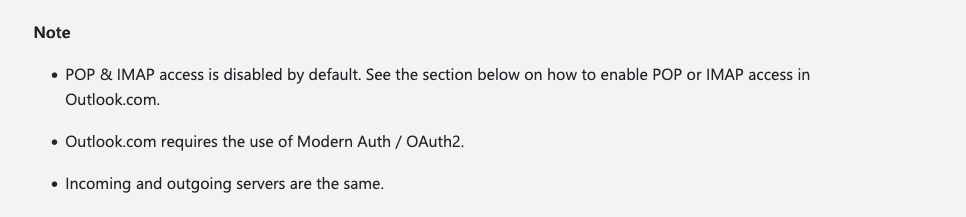
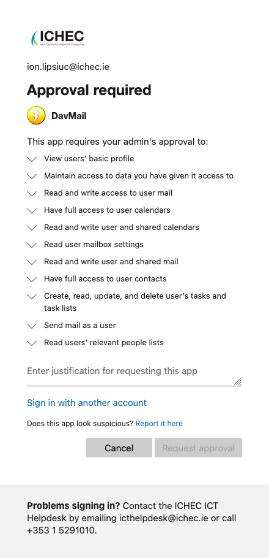

# aerc

## macOS

```shell
brew install aerc
```

## aerc setup for Microsoft 365

> [!NOTE]
> The following documents my attempt to get my ICHEC Outlook account working on
> aerc.

As per <https://man.sr.ht/~rjarry/aerc/providers/microsofto365.md>, we move
forward with the assumption that IMAP is enabled. As per [Microsoft
Email](https://man.sr.ht/~rjarry/aerc/providers/microsofto365.md#microsoft-email),
all we have to do is modify `accounts.conf` after the initial setup.

I wasn't too confident about this method after going through [POP, IMAP, and
SMTP settings for
Outlook](https://support.microsoft.com/en-us/outlook/pop-imap-and-smtp-settings-for-outlook-com)
and seeing the following note:



No luck with this method.

Instead of wasting time with the assumption that IMAP is enabled, we move on to
[Office365 with IMAP
disabled](https://man.sr.ht/~rjarry/aerc/providers/microsofto365.md#office365-with-imap-disabled).
Download latest [Azul Zulu Build of
OpenJDK](https://www.azul.com/downloads/?os=macos&package=jdk-fx#zulu) and
[`DavMail-MacOSX-7.1.0-4498.app.zip`](https://sourceforge.net/projects/davmail/files/davmail/7.1.0/DavMail-MacOSX-7.1.0-4498.app.zip/download).
Follow guide given in [DavMail Setup on macOS](https://davmail.sourceforge.net/macosxsetup.html).

Everything was going so smoothly until the following:



Fortunately, there is a [way to bypass this
approval](https://github.com/mguessan/davmail/issues/321#issuecomment-1867072418)...

It works! Simply add the following to `~/.config/davmail/davmail.properties`:

```text
davmail.oauth.clientId=d3590ed6-52b3-4102-aeff-aad2292ab01c
davmail.oauth.redirectUri=urn:ietf:wg:oauth:2.0:oob
```
