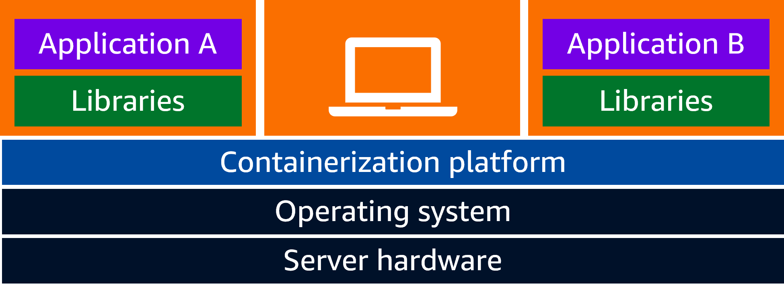
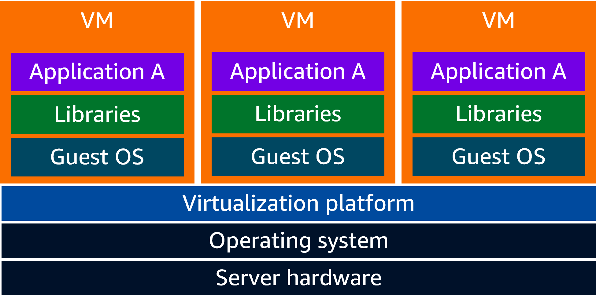
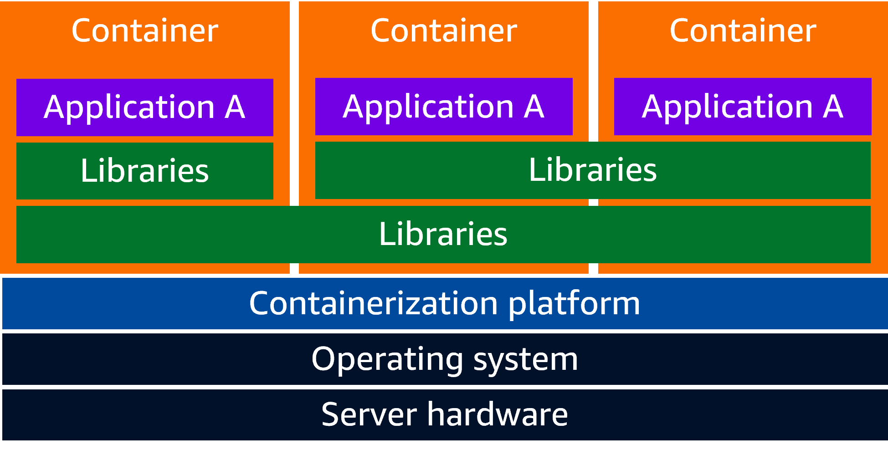

# AWS Skill Builder: Introduction to containers

A container is a standardised unit of software.

It contains everything needed to run an application.

FreeBSD jails are an OS-level virtualisation feature that allows one to
partition a system into several smaller systems sharing the same kernel.

Containers share the underlying host system's OS kernel.

An image is a read-only template with instructions for creating a container. A
running container is an instance of an image. An image is usually based on
another image with some customisation.
